<p align="center">
  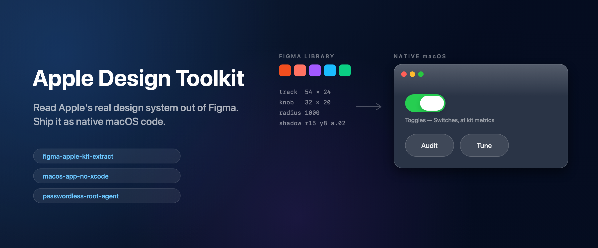
</p>

<p align="center">
  
  
  
  
  
</p>

<p align="center">
  <b>Four skills that turn Apple's published design system into working native code.</b><br>
  Every one exists because the obvious approach fails <i>silently</i> — it compiles, it runs, it looks almost right, and you cannot tell why it's wrong.
</p>

---

## Install

```bash
/plugin marketplace add infinitule/apple-design-toolkit
/plugin install apple-design-toolkit@apple-design-toolkit
```

Or drop any single `SKILL.md` into `~/.claude/skills/<name>/SKILL.md`. No dependencies, no build step — they're documents.

---

## What this actually solved

These aren't theoretical. They were extracted from building [**MacPulse**](https://github.com/infinitule/MacPulse), a Liquid Glass battery governor, where each of these problems cost a full rebuild before being diagnosed:

| What went wrong | What it looked like | The real cause | Skill |
|---|---|---|---|
| Glass panel looked like a **flat dark card** | Added more gradients. Twice. Still flat. | `.ultraThinMaterial` in a borderless `NSPanel` blends *within-window* — it can never sample the desktop | `macos-app-no-xcode` |
| App icon showed a **white card** behind it in the Dock | `frame.fills = []` was set; `sips -g hasAlpha` said `yes` | Figma's PNG export still returned **opaque corner pixels**; the alpha check proves nothing | `figma-apple-kit-extract` |
| Kit component search returned **nothing** | Query looked reasonable: `"window panel material glass button"` | The matcher is **single-term only** | `figma-apple-kit-extract` |
| A kit component **vanished** from a render | Imported successfully, placed correctly, invisible | Took `defaultVariant` — a `Mode=Dark` variant on a dark backdrop | `figma-apple-kit-extract` |
| Password prompt on **every** privileged action | The usual fix is telling users to edit `sudoers` | Needed a privilege architecture, not a workaround | `passwordless-root-agent` |
| Panel shadow was a **grey smudge** | One black blur, radius 22, α0.5 — fine on dark, filthy on light | Apple layers two shadows and scales them per appearance | `figma-apple-kit-extract` |

Every one of these is now a documented trap with the fix.

### Why this matters at all

<p align="center">
  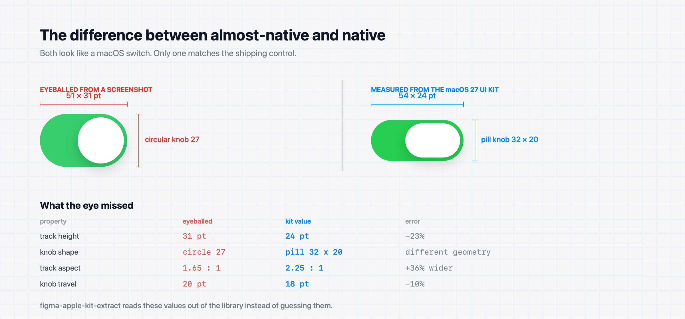
</p>

Both of those are green switches with a white knob. One is 23% too tall, uses a circular knob where Apple uses a 32 × 20 pill, and is 36% off on aspect ratio. Nobody can name what's wrong with it — they just feel that the app isn't quite a Mac app. **That gap is the entire reason this toolkit exists**, and it closes only by reading the real numbers.

---

## Apple elements used

The toolkit reads Apple's **official UI kits for Figma** (Apple Design Resources) — macOS 26/27, iOS & iPadOS 26/27, watchOS 26, visionOS 26. These are the real values it extracts, not approximations:

| Kit element | What gets measured | Value found in macOS 27 |
|---|---|---|
| `Toggles — Switches` | track, knob, shadow | 54 × 24 pt track · **32 × 20 pill knob** · y3 soft shadow |
| `Button` | geometry, fill stack, shadow | `cornerRadius: 1000` (true capsule) · layered `#444 @ 60%` + white lift + specular ring · shadow **r15 · y8 · α0.02** |
| `Button` effects | glass construction | `GLASS` effect + `INNER_SHADOW` pairs at ±40 y — the specular **top and bottom** edges |
| Kit variables | design tokens | `Button/Radius`, `Button/Padding-Horizontal`, `Toggle (Switch)/Track-Width`, `Knob-Width` … |
| Component variants | state matrix | `Mode=Dark\|Light` × `Size=Medium\|XL` × `State=Idle\|Clicked\|Disabled` × `Active` |
| SF Pro / SF Symbols | type ramp, iconography | system-provided; 11 / 13 / 15 pt ramp |

> The banner above is not decoration: those controls were **rebuilt in code from these exact measured values**. That is the whole point of the toolkit.

<p align="center">
  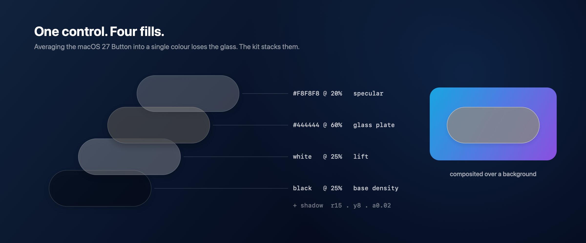
</p>

A single control is not a single colour. The kit's Button is **four translucent fills stacked** — base density, lift, glass plate, specular sheen — plus a whisper-soft shadow. Flatten them into one averaged colour, as an eyeball inevitably does, and the glass is gone: the control stops responding to whatever sits behind it. Extracting the stack is what keeps it alive.

---

## Studies

Six drawings from the library. No screenshots, no traced artwork — every measurement is read from the kit and rendered by [`images.swift`](images.swift). If the extracted values were wrong, these would be wrong.

<p align="center">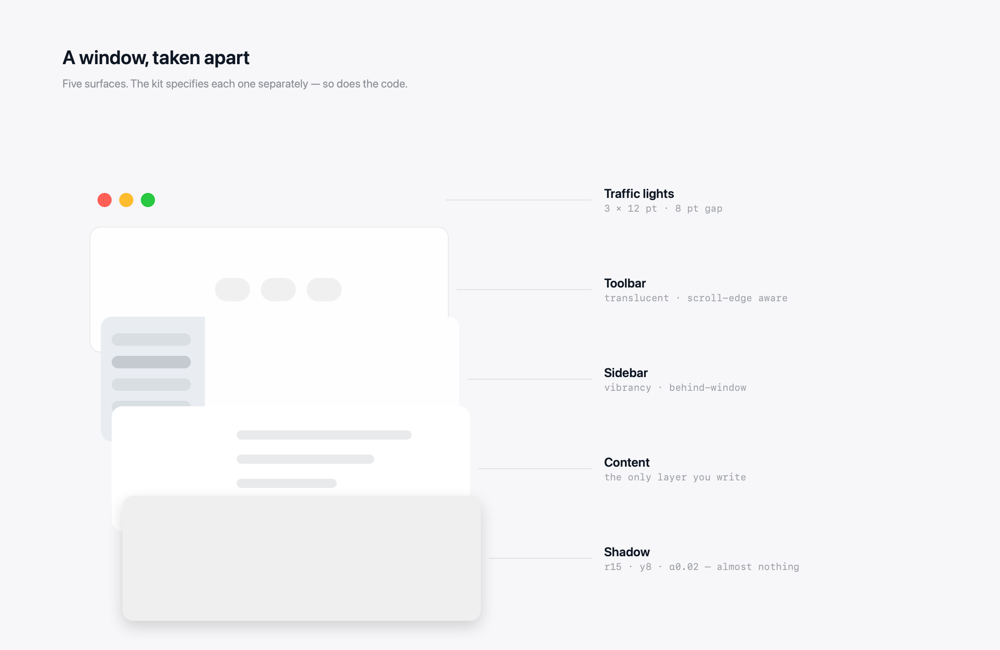</p>

**A window, taken apart.** Traffic lights, toolbar, sidebar, content, shadow. The kit specifies each surface separately, and so must the code — the sidebar's vibrancy is not the toolbar's translucency.

<p align="center">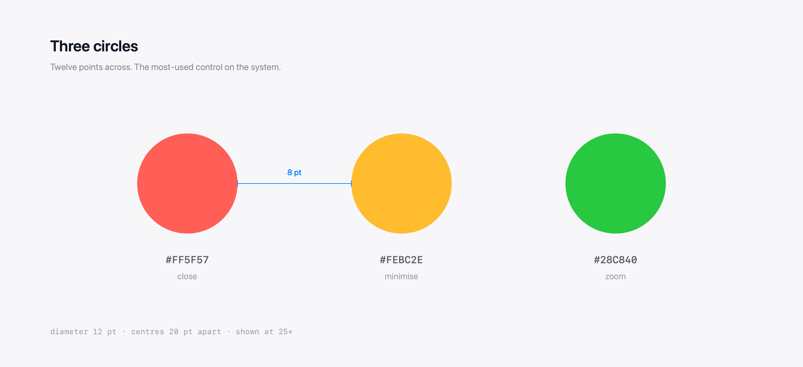</p>

**Three circles.** Twelve points across, twenty apart. Shown at 25×, because at 1× nobody questions them — and that is exactly why they get drawn wrong.

<p align="center">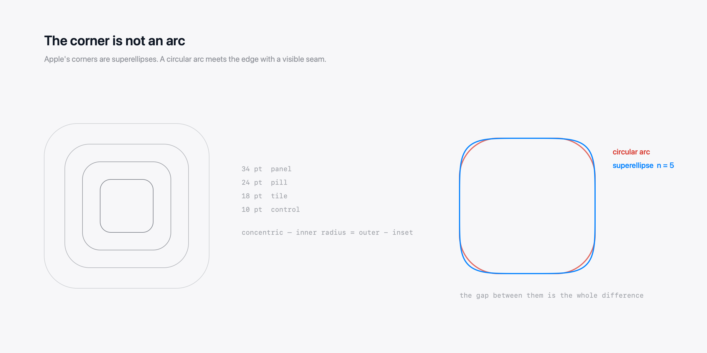</p>

**The corner is not an arc.** Apple's corners are superellipses. Overlay a circular arc on the same box and the two visibly separate — that gap is why a hand-rolled rounded rectangle never quite looks right.

<p align="center">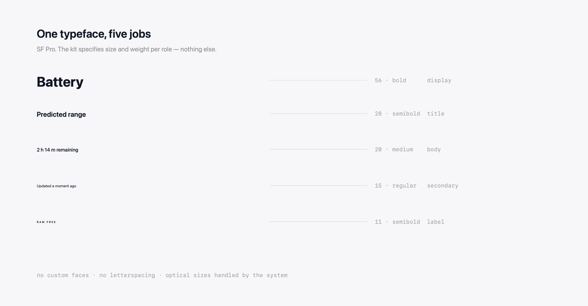</p>

**One typeface, five jobs.** The kit assigns size and weight per role. There is no custom face, no letterspacing, no optical fudging — the restraint *is* the system.

<p align="center">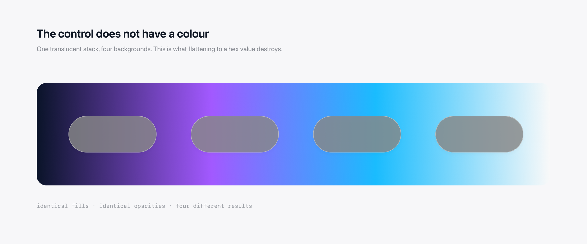</p>

**The control does not have a colour.** Identical fills and opacities over four backdrops, four different results. Flatten it to a hex value and this dies.

<p align="center">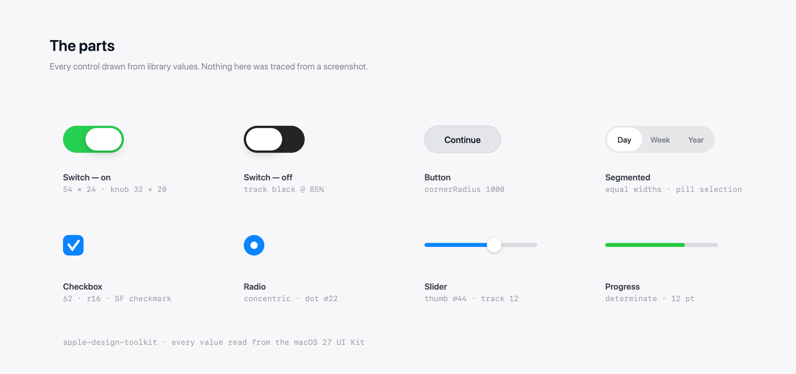</p>

**The parts.** Switch, button, segmented, checkbox, radio, slider, progress — every one at library metrics.

---

## The skills, in detail

### 1. `figma-apple-kit-extract`

**The problem it solves.** You want your app to look like Apple's. So you screenshot the HIG, eyeball a corner radius, guess a shadow, and end up with something that reads as *almost* native — the uncanny valley of Mac apps. Apple publishes the actual numbers in their Figma kits, but the path from "kit exists" to "value in my Swift file" is undocumented and full of dead ends.

**What it does.** Gives you the complete extraction pipeline:

```
get_libraries(fileKey)                        → every attached kit's libraryKey
  ↓
search_design_system("button", …, [kitKey])   → componentKey + assetType
  ↓
use_figma: importComponentSetByKeyAsync       → instantiate, walk, measure
  ↓
fills / radii / effects / paddings            → SwiftUI values
```

It also covers the macOS 27 **Liquid Glass anatomy** (why the glass plate is a *stack* of translucent fills, never one averaged colour), building **parametric faceted icon marks** (miter-offset ribbon geometry, per-facet normal shading), and the full `.icns` export chain.

**The traps it saves you from:**
- Search matches **single terms only** — multi-word queries silently return `{}`
- Community kit "duplicates" often contain **only a Cover page**; check with `get_metadata` before building on sand
- `get_design_context` hard-errors with *"nothing selected"* — the import-and-measure path needs no selection
- Kit variables often resolve to `VARIABLE_ALIAS`, not values
- **`frame.fills = []` does not guarantee transparent PNG corners**, and `sips -g hasAlpha` will lie to you about it

**One non-obvious gain:** it tells you to use semantic `Color.primary.opacity(x)` rather than hardcoded `.white`, which makes an entire UI adapt to light/dark for free — while keeping *specular* highlights literally white, because those are physical, not semantic.

---

### 2. `macos-app-no-xcode`

**The problem it solves.** An Xcode project is a large, opaque, hard-to-review artifact for what is often a few hundred lines of SwiftUI. And if you want a floating HUD panel — a Dynamic-Island-style surface — the mechanics are scattered across a dozen AppKit APIs that don't appear in SwiftUI tutorials.

**What it does.** Ships a real, signed `.app` from a **single Swift file**:

```bash
swiftc -O main.swift -o MyApp     # file MUST be main.swift for top-level code
# assemble Contents/{MacOS,Resources}, write Info.plist, codesign -s -
```

Plus the floating-panel recipe: `NSPanel` with `[.borderless, .nonactivatingPanel]`, `level = .statusBar`, clear background, `canBecomeKey` override for Esc, top-anchored frame resizing synchronised with a SwiftUI spring, and `LSUIElement` for a menu-bar-only app with no Dock icon.

**The headline trap — and it cost two full rebuilds to find:**

> SwiftUI's `.ultraThinMaterial` inside a borderless `NSPanel` blends **within-window only**. It renders as a flat dark card, and **no quantity of additional gradients will ever fix it**, because the view is not sampling the desktop at all. You need `NSVisualEffectView` with `blendingMode = .behindWindow`.

```swift
struct GlassBackdrop: NSViewRepresentable {
    func makeNSView(context: Context) -> NSVisualEffectView {
        let v = NSVisualEffectView()
        v.material = .hudWindow
        v.blendingMode = .behindWindow   // ← the entire fix
        v.state = .active
        return v
    }
    func updateNSView(_ v: NSVisualEffectView, context: Context) {}
}
```

It also records the diagnostic that makes this verifiable: `screencapture -o -l<windowid>` renders the glass **grey**, because in isolation the vibrancy view has nothing to sample. That greyness is *proof it's working* — mistake it for a bug and you'll "fix" your way back to a flat card. Region-capture instead to see real refraction.

Apple's own `.glassEffect` API requires macOS 26+, so below that the skill documents hand-building it: specular band top, **counter-light band bottom** (the most-forgotten cue — without it a panel reads as paper), gradient rim, cursor-tracking highlight via `.onContinuousHover`, and layered contact + ambient shadows.

---

### 3. `passwordless-root-agent`

**The problem it solves.** Your app needs `pmset`, `powermetrics`, or similar — repeatedly. Your three bad options: prompt for a password every single time (users quit), instruct users to hand-edit `sudoers` with `NOPASSWD` (a standing hole, and most won't), or adopt `SMJobBless` (heavyweight, and requires a paid developer identity).

**What it does.** One admin prompt, ever. A root LaunchDaemon watches a sticky world-writable spool directory via `WatchPaths`; the app drops a request file; the daemon answers.

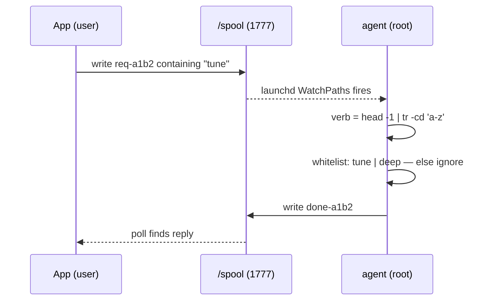

**The security invariant that makes it safe:** a request file contains **one bare verb and nothing else** — no paths, no flags, no arguments. The agent strips everything but lowercase letters, matches a fixed whitelist, and constructs every output path itself. The spool is world-writable *by design*, and it doesn't matter: there is no string a hostile process can place there that reaches a shell. The worst it can do is ask for an operation the user already authorised.

Supporting rules the skill enforces: the agent script must be **root-owned** (root must never execute a user-writable file — that's the escalation everyone misses), reply ids are sanitised, stale replies swept. It also covers the companion pattern — a `StartInterval` telemetry daemon — including the `ioreg -rn AppleSmartBattery` parsing traps: nested dictionaries repeat key names, and `InstantAmperage` is unsigned two's complement, so an unguarded read reports drain in quintillions of watts.

---

### 4. `gated-tool-preflight`

**The problem it solves.** Agent harnesses increasingly wrap tools in policy hooks that reject a call and demand justification first. The expensive failure is not the gate — it is *fail → read the demand → retry the identical call*, repeated for an entire session because nothing was learned from the first denial. At volume this dominates both cost and latency.

**What it does.** Teaches the diagnosis first, because there are two kinds of gate and they need opposite responses:

- **Content-checking gates** read your message and pass once the declaration is present. Preamble prevents the denial outright — so state callers, rollback command, data shapes and the verbatim instruction *before* the call, and batch one preamble across several pending calls.
- **Unconditional speed bumps** fire on the first occurrence of a trigger (first Bash of a session, first write to a path) regardless of what you wrote, and accept a byte-identical retry. No preamble can prevent these.

Trying to satisfy the second kind with better prose is pure waste. The skill's answer is to **reduce trigger count** instead: extend one file rather than creating six siblings, collapse build-deploy-verify into a single command, use `mktemp -d` rather than `rm -rf`, patch once with a script instead of issuing N edits — and surface the harness's documented disable path to the user rather than silently absorbing the cost for a hundred calls.

**Why it belongs here:** this toolkit was built under exactly such a harness, and the diagnosis above was made by testing it — declaring everything up front, watching the gate fire anyway, then observing an identical retry succeed.

---

## How they compose

```mermaid
graph LR
  F["Apple's Figma UI kit"] -->|figma-apple-kit-extract| V["exact values<br/>54×24 · r1000 · α0.02"]
  V --> S["SwiftUI views"]
  S -->|macos-app-no-xcode| A["signed .app<br/>real behind-window glass"]
  A -->|passwordless-root-agent| P["privileged operations<br/>after one prompt"]
  style F fill:#12325c,stroke:#4FC3FF,color:#e9eef6
  style V fill:#2a1f52,stroke:#B79CFF,color:#e9eef6
  style S fill:#2a1f52,stroke:#B79CFF,color:#e9eef6
  style A fill:#0f3d22,stroke:#30D158,color:#e9eef6
  style P fill:#4a2408,stroke:#FF9F0A,color:#e9eef6
```

Independently useful; together they take you from a published design system to a shipped, privileged native app.

## Regenerate the imagery

```bash
swift images.swift
```

Every control in every image on this page is drawn from the measured kit values — no screenshots, no traced artwork. Change a number and watch it move. That is also the honest test of the toolkit: if the extracted values were wrong, these images would look wrong.

> **On logos:** the Figma relationship is shown through Figma's brand colour language rather than its logo, and there is no Apple logo anywhere. Apple's trademark guidelines prohibit third-party use of the Apple logo, and putting one here would contradict the independence notice below. The colour language communicates the same idea without borrowing anyone's mark.

## Provenance

Every technique was derived from getting something wrong and diagnosing it, not from reading documentation. [MacPulse](https://github.com/infinitule/MacPulse) is all three in production, with its own full write-up of the control theory behind it.

## Attribution

macOS, the macOS UI Kit, SF Pro and SF Symbols are trademarks and copyrighted works of **Apple Inc.** This project describes how to *work with* Apple's publicly published design resources and **contains no Apple assets** — the controls in the banner are original code drawn from published measurements. Not affiliated with, endorsed by, or sponsored by Apple Inc.

## License

MIT — see [LICENSE](LICENSE).
